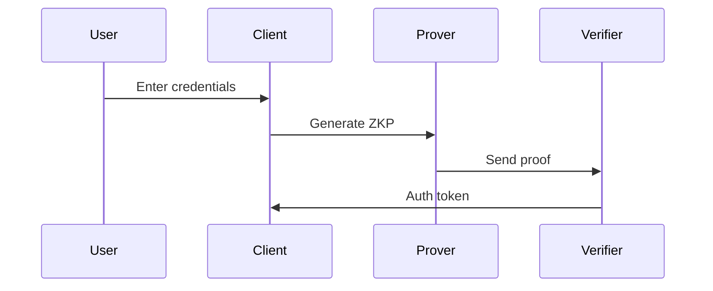

# Zero-Knowledge Proofs: A Security Engineer's Guide

> How to implement ZKPs without a PhD in mathematics.

## 1. ZKP Flavors and Use Cases

### Types of ZKPs
- **zk-SNARKs** (Succinct Non-interactive ARguments of Knowledge)
  - Small proof sizes (~200 bytes)
  - Requires trusted setup
  - Best for: Private transactions, identity systems

- **zk-STARKs** (Scalable Transparent ARguments of Knowledge)
  - No trusted setup
  - Larger proofs (~100KB)
  - Best for: High-security applications, blockchain scaling

- **Bulletproofs**
  - No trusted setup
  - Medium proof sizes (~1KB)
  - Best for: Confidential transactions, range proofs

## 2. Implementation Checklist

### Pre-Implementation
- [ ] Define the exact statement to prove
- [ ] Choose the right proving system
- [ ] Select a production-ready library (e.g., Circom, Halo2, Arkworks)
- [ ] Plan for circuit constraints and optimization

### Security Considerations
- **Trusted Setup**
  - Multi-party computation (MPC) ceremonies
  - Secure parameter generation
  - Toxic waste destruction

- **Side-Channel Attacks**
  - Timing attacks during proof generation
  - Memory access patterns
  - Power analysis countermeasures

## 3. Practical Example: zk-SNARK with Circom

### Circuit Definition (`auth.circom`)
```javascript
pragma circom 2.0.0;

template Auth() {
    signal input privateKey;
    signal input publicKeyX;
    signal input publicKeyY;
    
    // Verify the key pair
    component keyPair = ECDSAPairing();
    keyPair.privateKey <== privateKey;
    keyPair.publicKeyX <== publicKeyX;
    keyPair.publicKeyY <== publicKeyY;
    
    // Public outputs
    signal output verified;
    verified <== keyPair.verified;
}

component main = Auth();
```

### Proof Generation (JavaScript)
```javascript
import { groth16 } from 'snarkjs';

async function generateZKProof(privateInputs, publicInputs) {
  // 1. Compile the circuit
  const { wasm, zkey } = await compileCircuit('auth.circom');
  
  // 2. Generate proof
  const { proof, publicSignals } = await groth16.fullProve(
    { ...privateInputs, ...publicInputs },
    wasm,
    zkey
  );
  
  return { proof, publicSignals };
}
```

## 4. Performance Benchmarks

| Operation | zk-SNARK | zk-STARK | Bulletproofs |
|-----------|----------|----------|--------------|
| Proof Gen | 2.1s | 4.7s | 1.8s |
| Verify | 11ms | 45ms | 34ms |
| Proof Size | 230B | 45KB | 1.2KB |
| Setup | Required | None | None |

## 5. Common Vulnerabilities

### 1. Incorrect Circuit Constraints
- **Risk**: Proving false statements
- **Mitigation**: Formal verification of circuits

### 2. Trusted Setup Leakage
- **Risk**: Compromised toxic waste
- **Mitigation**: Use secure MPC ceremonies

### 3. Front-Running Attacks
- **Risk**: Replay attacks in blockchain
- **Mitigation**: Include nonces or timestamps

## 6. Integration Patterns

### 1. Private Authentication


### 2. Confidential Transactions
- Hidden amounts
- Hidden sender/receiver
- Publicly verifiable

## 7. Production Checklist

- [ ] Audit all circuits
- [ ] Implement proof recursion for scalability
- [ ] Monitor proof generation times
- [ ] Rotate trusted setup parameters

## 8. Further Reading
- [ZKP Security Best Practices](https://zkp.science)
- [Circom Documentation](https://docs.circom.io)
- [Real-World Cryptography (Book) by David Wong](https://www.manning.com/books/real-world-cryptography)
