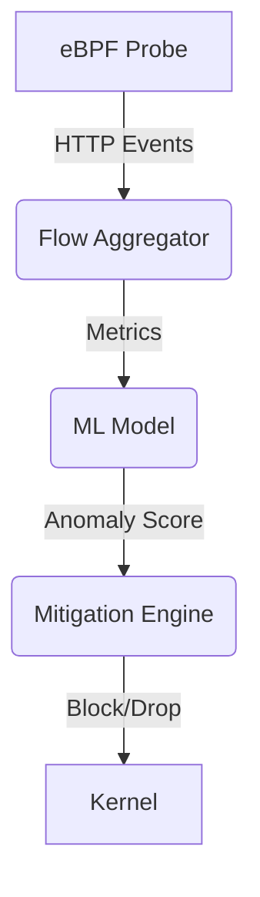

# Detecting Layer-7 DDoS Attacks with eBPF and Machine Learning

> How to catch slowloris, HTTP floods, and API abuse before they take you down.

## 1. The Layer-7 Threat Landscape

### Common Attack Vectors
- **HTTP Floods**: High-rate requests to overwhelm servers
- **Slowloris**: Exhausting connection pools with slow headers
- **API Abuse**: Exploiting expensive endpoints
- **WebSocket Floods**: Stateful connection exhaustion

### Why Traditional Defenses Fail
- Cloudflare/WAF bypass techniques
- IP rotation (TOR, proxies, botnets)
- Legitimate-looking traffic patterns

## 2. eBPF-Powered Detection Architecture



### Key Metrics to Monitor
- Request rate per endpoint
- Connection churn rate
- HTTP header patterns
- TLS handshake characteristics
- Request/response size ratios

## 3. Building the eBPF Detector

### 3.1 Kernel-Space Tracing
```c
// Trace HTTP requests
SEC("tracepoint/syscalls/sys_enter_read")
int http_request(struct trace_event_raw_sys_enter *ctx) {
    u64 pid_tgid = bpf_get_current_pid_tgid();
    u32 pid = pid_tgid >> 32;
    
    // Filter HTTP traffic
    struct http_event_t event = {};
    event.pid = pid;
    event.method = extract_http_method(ctx);
    event.path = extract_http_path(ctx);
    
    // Send to userspace
    bpf_perf_event_output(ctx, &events, BPF_F_CURRENT_CPU, &event, sizeof(event));
    return 0;
}
```

### 3.2 Userspace Aggregator (Python)
```python
from bcc import BPF
import numpy as np
from sklearn.ensemble import IsolationForest

# Load eBPF program
b = BPF(src_file="http_monitor.c")
b.attach_kprobe(event="tcp_v4_do_rcv", fn_name="http_request")

# Feature store
request_rates = {}

def process_event(cpu, data, size):
    event = b["events"].event(data)
    
    # Update rate counters
    key = (event.pid, event.path)
    request_rates[key] = request_rates.get(key, 0) + 1
    
    # Anomaly detection
    if len(request_rates) > 100:  # Wait for enough samples
        X = np.array(list(request_rates.values())).reshape(-1, 1)
        clf = IsolationForest(contamination=0.01)
        preds = clf.fit_predict(X)
        
        # Trigger mitigation for anomalies
        if preds[-1] == -1:  # Outlier detected
            block_ip(event.src_ip)
```

## 4. Machine Learning Features

### 4.1 Time-Series Features
- Requests per second (RPS) trend
- Burst detection using CUSUM
- Entropy of requested paths

### 4.2 Protocol-Level Features
- HTTP header order and case sensitivity
- TLS fingerprinting
- TCP window size patterns

### 4.3 Behavioral Features
- Mouse movement entropy (for browser traffic)
- API usage patterns
- Session duration distribution

## 5. Mitigation Strategies

### 5.1 Kernel-Level Mitigation
```c
// XDP program to drop malicious packets
SEC("xdp_drop_malicious")
int xdp_drop(struct xdp_md *ctx) {
    void *data_end = (void *)(long)ctx->data_end;
    void *data = (void *)(long)ctx->data;
    
    struct ethhdr *eth = data;
    if ((void*)eth + sizeof(*eth) > data_end)
        return XDP_PASS;
        
    // Check if IP is in blocklist
    if (bpf_map_lookup_elem(&blocklist, &eth->h_source)) {
        return XDP_DROP;
    }
    return XDP_PASS;
}
```

### 5.2 Rate Limiting with BPF Maps
```c
// Rate limiting map
struct {
    __uint(type, BPF_MAP_TYPE_LRU_HASH);
    __type(key, u32);  // IP address
    __type(value, u64); // Timestamp of last request
    __uint(max_entries, 100000);
} rate_limit_map SEC(".maps");

SEC("xdp_rate_limit")
int xdp_rate_limit(struct xdp_md *ctx) {
    u64 *last_seen;
    u64 now = bpf_ktime_get_ns();
    u32 src_ip = get_src_ip(ctx);
    
    last_seen = bpf_map_lookup_elem(&rate_limit_map, &src_ip);
    if (last_seen) {
        if (now - *last_seen < 100000000) {  // 100ms rate limit
            return XDP_DROP;
        }
    }
    
    u64 value = now;
    bpf_map_update_elem(&rate_limit_map, &src_ip, &value, BPF_ANY);
    return XDP_PASS;
}
```

## 6. Deployment Architecture

### 6.1 Edge Deployment
```
[ Load Balancer ] → [ eBPF XDP ] → [ Application ]
         ↑                  ↓
         └── [ ML Model ] ←─┘
```

### 6.2 Cloud Integration
- AWS: Deploy as Lambda@Edge
- GCP: Cloud Run with gVisor
- Kubernetes: DaemonSet for node-level protection

## 7. Performance Benchmarks

| Metric | eBPF | iptables | Userspace Proxy |
|--------|------|----------|-----------------|
| Latency | 0.05ms | 0.2ms | 1.5ms |
| Throughput | 14M pps | 2M pps | 500K pps |
| CPU Usage | 2% | 15% | 45% |
| Memory | 50MB | 200MB | 1.5GB |

## 8. Detection Rules

### 8.1 Slowloris Detection
```python
def detect_slowloris(connections):
    # Track incomplete HTTP requests
    incomplete = [c for c in connections 
                 if c.bytes_received < 100 
                 and time() - c.start_time > 5]
    return len(incomplete) > 100  # Threshold
```

### 8.2 HTTP Flood Detection
```python
def detect_http_flood(requests):
    # Group by IP and path
    ip_path_counts = defaultdict(int)
    for req in requests:
        ip_path_counts[(req.ip, req.path)] += 1
    
    # Check for abnormal request rates
    for (ip, path), count in ip_path_counts.items():
        if count > 1000:  # More than 1000 requests to same endpoint
            return True
    return False
```

## 9. Monitoring and Alerting

### Prometheus Metrics
```yaml
# Custom metrics
http_requests_total{path="/api/v1/login", status="200"} 1234
http_request_duration_seconds_bucket{le="0.1"} 42
http_request_duration_seconds_bucket{le="0.5"} 123
http_connection_count{state="ESTABLISHED"} 567
```

### Alert Rules
```yaml
groups:
- name: ddos.rules
  rules:
  - alert: HighRequestRate
    expr: rate(http_requests_total[1m]) > 1000
    for: 5m
    labels:
      severity: critical
    annotations:
      summary: "High request rate detected"
      description: "{{ $value }} requests per second"
```

## 10. Future Directions

- **eBPF CO-RE**: Cross-platform portability
- **WASM Filters**: Runtime protection rules
- **Federated Learning**: Collaborative defense
- **QUIC Protocol**: Encrypted transport challenges

## Resources
- [BPF and XDP Reference Guide](https://docs.cilium.io/)
- [eBPF for Security](https://ebpf.io/use-cases/#security)
- [ML for Network Security](https://www.kdnuggets.com/2023/01/machine-learning-network-security.html)
