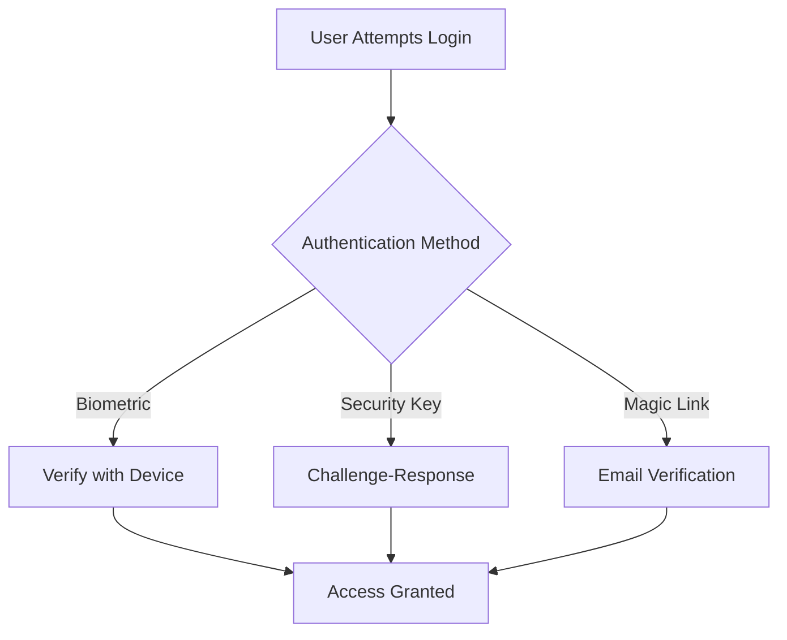

# The Complete Guide to Passwordless Authentication in 2025

In an era where 81% of data breaches involve stolen or weak credentials, the cybersecurity industry is rapidly moving beyond traditional passwords. Passwordless authentication has emerged as the new standard, with 92% of enterprises planning to implement passwordless solutions by 2026. This comprehensive guide explores the current state, technologies, and future of passwordless authentication.

## The Case for Going Passwordless

### The Problem with Passwords
- **Security Vulnerabilities**: 80% of breaches involve compromised credentials
- **User Experience**: Average user manages 100+ passwords
- **Operational Costs**: $70-300 per user annually in password management
- **Productivity Loss**: 20-50% of help desk calls are password-related

### Passwordless Authentication Market Growth
- **Market Size**: $15.6 billion in 2025 (CAGR 31.1% from 2020)
- **Adoption Rate**: 60% of large enterprises have implemented some form of passwordless auth
- **User Preference**: 78% of users prefer passwordless methods over traditional passwords

## Core Passwordless Authentication Methods

### 1. Biometric Authentication
- **Fingerprint Recognition**: 98% accuracy rate in modern implementations
- **Facial Recognition**: 3D mapping with liveness detection
- **Iris Scanning**: Used in high-security environments
- **Behavioral Biometrics**: Keystroke dynamics, mouse movements, and touch patterns
- **Voice Recognition**: Advanced anti-spoofing measures

### 2. Possession-Based Methods
- **Security Keys**: FIDO2/WebAuthn compliant devices (YubiKey, Titan)
- **Smart Cards**: Physical cards with embedded chips
- **Mobile Devices**: Smartphones as authentication factors
- **Wearables**: Smartwatches and fitness trackers

### 3. Magic Links & One-Time Passwords
- **Email Magic Links**: Time-limited, single-use authentication links
- **SMS OTP**: Still common but being phased out due to vulnerabilities
- **Authenticator Apps**: Time-based one-time passwords (TOTP)
- **Push Notifications**: Approve login attempts via mobile apps

## Technical Implementation

### WebAuthn & FIDO2 Standards
- **WebAuthn**: W3C standard for web authentication
- **FIDO2**: Framework for passwordless authentication
- **CTAP2**: Client to Authenticator Protocol for external authenticators

### Implementation Architecture

### Security Considerations
- **Phishing Resistance**: Cryptographic proof of origin
- **Man-in-the-Middle Protection**: Public key cryptography
- **Account Recovery**: Secure fallback mechanisms
- **Multi-factor Authentication**: Combining multiple passwordless factors

## Industry Adoption & Case Studies

### Enterprise Implementations
- **Microsoft**: Passwordless authentication across Azure AD
- **Google**: Advanced Protection Program with security keys
- **Apple**: Passkeys with iCloud Keychain sync
- **Banking Sector**: 67% of top 100 banks implementing passwordless solutions

### Success Story: Financial Services Firm
**Challenge**: High-volume credential stuffing attacks
**Solution**: Implemented FIDO2 security keys for all employees
**Results**:
- 99.9% reduction in account takeovers
- 70% faster login times
- $1.2M annual savings in password-related support

## Implementation Roadmap

### Phase 1: Assessment (Weeks 1-4)
- Audit current authentication systems
- Identify use cases and user personas
- Select appropriate passwordless methods
- Evaluate vendor solutions vs. in-house development

### Phase 2: Pilot (Weeks 5-12)
- Implement in non-production environment
- Test with 5-10% of users
- Gather feedback and metrics
- Refine user experience

### Phase 3: Rollout (Weeks 13-24)
- Phased deployment to different user groups
- Comprehensive user training
- Monitor security and performance metrics
- Continuous improvement based on feedback

## Challenges & Mitigation Strategies

### Technical Challenges
- **Legacy System Integration**: Use authentication proxies
- **Cross-Platform Support**: Implement multiple authentication methods
- **User Enrollment**: Streamline onboarding processes

### User Adoption
- **Education**: Clear communication of benefits
- **Incentives**: Gamification and rewards
- **Support**: Comprehensive help resources

### Security Considerations
- **Biometric Data Storage**: On-device storage only
- **Fallback Mechanisms**: Secure account recovery options
- **Continuous Authentication**: Monitor for suspicious behavior

## The Future of Passwordless Authentication

### Emerging Technologies
- **Decentralized Identity**: Blockchain-based self-sovereign identity
- **Passwordless SSO**: Seamless cross-application authentication
- **AI-Powered Authentication**: Adaptive risk-based authentication
- **Quantum-Resistant Cryptography**: Preparing for post-quantum security

### Industry Predictions
- By 2027: 90% of enterprises will be passwordless
- 2026: Biometric authentication will be standard on all devices
- 2028: Passwords will be considered legacy technology

## Getting Started with Passwordless

### For Individuals:
1. Enable biometric authentication on all devices
2. Use a password manager with passwordless options
3. Adopt security keys for critical accounts
4. Enable passkeys where available

### For Organizations:
1. Conduct a passwordless readiness assessment
2. Start with privileged accounts
3. Implement FIDO2/WebAuthn standards
4. Train employees on new authentication methods

## Conclusion & Key Takeaways

1. **Passwordless is Inevitable**: The shift is happening now across all industries
2. **Security & UX Go Hand-in-Hand**: Modern solutions improve both
3. **Start Small, Scale Fast**: Begin with pilot programs before organization-wide deployment
4. **User Education is Critical**: Adoption requires understanding and trust
5. **Future-Proof Your Strategy**: Plan for emerging authentication technologies

## Additional Resources
- [FIDO Alliance](https://fidoalliance.org/)
- [NIST Digital Identity Guidelines](https://pages.nist.gov/800-63-3/)
- [Microsoft Passwordless Strategy](https://www.microsoft.com/security/business/identity/passwordless)

Passwordless authentication represents the future of digital identity. By understanding and implementing these technologies, organizations can significantly enhance security while improving the user experience.
