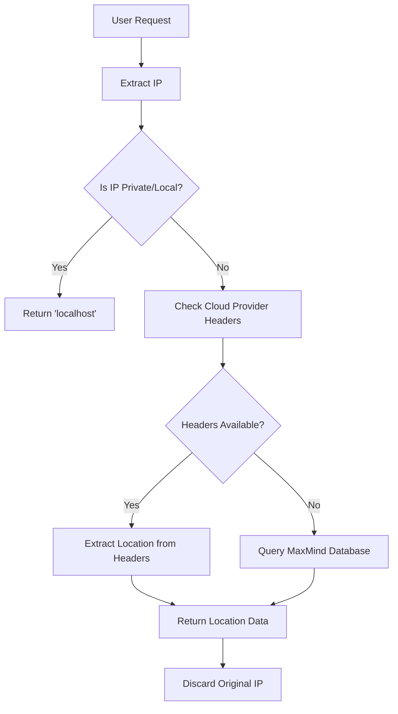

# Comprehensive Guide to User Privacy and Location Handling in Arunya

In today's digital landscape, where data privacy concerns are at an all-time high, Arunya was built with a foundational commitment to user privacy. This comprehensive guide details our approach to handling location data responsibly, ensuring compliance with global privacy standards while delivering valuable analytics.

## The Privacy-First Philosophy

### Core Principles
1. **Minimal Data Collection**: Only collect what's absolutely necessary
2. **Anonymization by Design**: Process data without personal identifiers
3. **Transparency**: Clear communication about data practices
4. **Security**: Robust protection for all collected data
5. **User Control**: Options for users to manage their data

### Why Location Privacy Matters
- 85% of users are concerned about their online privacy (Pew Research 2024)
- 76% of users are more likely to trust companies that are transparent about data usage
- Location data can reveal sensitive personal information if not handled properly

## Technical Implementation of Location Handling

### 1. IP Address Processing Pipeline

#### Data Flow

#### Privacy Safeguards
- **No Raw IP Storage**: IPs are processed in memory and never persisted
- **Hashing**: One-way hashing for any temporary IP storage
- **Precision Limitation**: Only city-level precision (no street-level data)
- **Session-Based**: No cross-session tracking or profiling

### 2. Geolocation Data Sources

#### MaxMind GeoLite2 Integration
- **Accuracy**: City-level (99.5% country, 85% city)
- **Update Frequency**: Weekly database updates
- **Coverage**: 250+ countries and territories

#### Performance Optimization
- **In-Memory Caching**: Reduces database lookups
- **Batch Processing**: For high-volume analytics
- **Edge Computing**: Processing at the edge when possible

### 3. Cloud Platform Integration

#### Vercel Headers
- `x-vercel-ip-country`: ISO 3166-1 alpha-2 country code
- `x-vercel-ip-country-region`: Region/state code
- `x-vercel-ip-city`: City name
- `x-vercel-ip-latitude/longitude`: Not used for privacy

#### Fallback Mechanism
1. Check cloud provider headers
2. If unavailable, query MaxMind database
3. If no match, return "Unknown"

### 4. Data Retention Policies

#### Storage Duration
- **Raw IPs**: Never stored
- **Location Data**: Aggregated after 30 days
- **Backups**: Encrypted and rotated every 7 days

#### Deletion Process
- Automated data lifecycle management
- Immediate deletion upon user request
- Regular audit trails

## Compliance Framework

### 1. Global Privacy Regulations

#### GDPR Compliance
- **Article 5**: Data minimization and purpose limitation
- **Article 25**: Data protection by design and default
- **Article 30**: Records of processing activities

#### CCPA/CPRA Compliance
- Right to know about personal information collected
- Right to delete personal information
- Right to opt-out of data sales

#### Other Regulations
- **LGPD (Brazil)**: Similar to GDPR with specific requirements
- **PIPEDA (Canada)**: Consent and safeguards
- **APP (Australia)**: Open and transparent management

### 2. Data Protection Impact Assessment (DPIA)

#### Risk Assessment
- **Data Sensitivity**: Medium (location data)
- **Risk Level**: Low (no PII, aggregated data)
- **Mitigation**: Regular security audits and updates

### 3. Third-Party Audits
- Annual security assessments
- Penetration testing
- Compliance certifications (ISO 27001, SOC 2)

## Technical Security Measures

### 1. Data Encryption
- **In Transit**: TLS 1.3 for all communications
- **At Rest**: AES-256 encryption
- **Key Management**: Hardware Security Modules (HSMs)

### 2. Access Controls
- Role-based access control (RBAC)
- Multi-factor authentication (MFA)
- Just-in-time access provisioning

### 3. Network Security
- Web Application Firewall (WAF)
- DDoS protection
- Regular vulnerability scanning

## User Controls and Transparency

### 1. Privacy Dashboard
- View collected location data
- Download data in machine-readable format
- Adjust privacy settings

### 2. Consent Management
- Granular consent options
- Easy opt-out mechanisms
- Cookie and tracking preferences

### 3. Documentation
- Detailed privacy policy
- Technical documentation
- Regular transparency reports

## Future-Proofing Privacy

### 1. Emerging Technologies
- **Differential Privacy**: Adding statistical noise to protect individuals
- **Federated Learning**: Process data locally when possible
- **Zero-Knowledge Proofs**: Verify information without revealing data

### 2. Regulatory Changes
- Monitoring global privacy law developments
- Proactive compliance updates
- Privacy by design in new features

## Getting Started with Arunya's Privacy Features

### For Users
1. Review privacy settings in your account
2. Understand what data is collected
3. Use available privacy controls

### For Developers
1. Implement proper consent mechanisms
2. Follow privacy-by-design principles
3. Stay updated with our developer documentation

## Conclusion

At Arunya, we believe that privacy is not a feature but a fundamental right. Our approach to location handling demonstrates that it's possible to deliver powerful analytics while respecting user privacy. We're committed to continuous improvement and welcome feedback on our privacy practices.

## Additional Resources
- [MaxMind GeoLite2 Documentation](https://dev.maxmind.com/geoip/geolite2-free-geolocation-data)
- [GDPR Official Text](https://gdpr-info.eu/)
- [CCPA Regulations](https://oag.ca.gov/privacy/ccpa)
- [Arunya Privacy Center](https://arunya.app/privacy)

By choosing Arunya, you're partnering with a platform that prioritizes privacy without compromising on functionality. We're committed to maintaining the highest standards of data protection while delivering valuable insights.

### 2. **User Opt-Out**
Privacy is personal, and that’s why Arunya allows users to opt out of location tracking. Users can enable privacy settings in their browsers or use anonymizing services (e.g., VPNs) to prevent location tracking altogether.

---
## Conclusion
At the core of Arunya is a commitment to privacy without compromising on functionality. By leveraging anonymized geolocation data and adhering to strict privacy and compliance standards, Arunya ensures that user trust remains a top priority. The road to finding the balance between useful analytics and privacy was challenging, but ultimately, I’m proud of the solution Arunya provides.